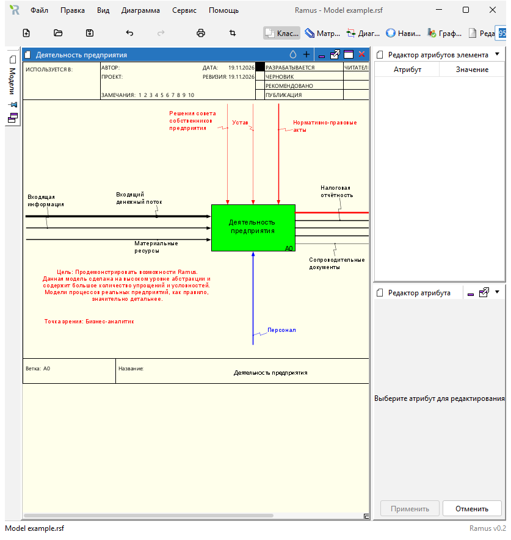
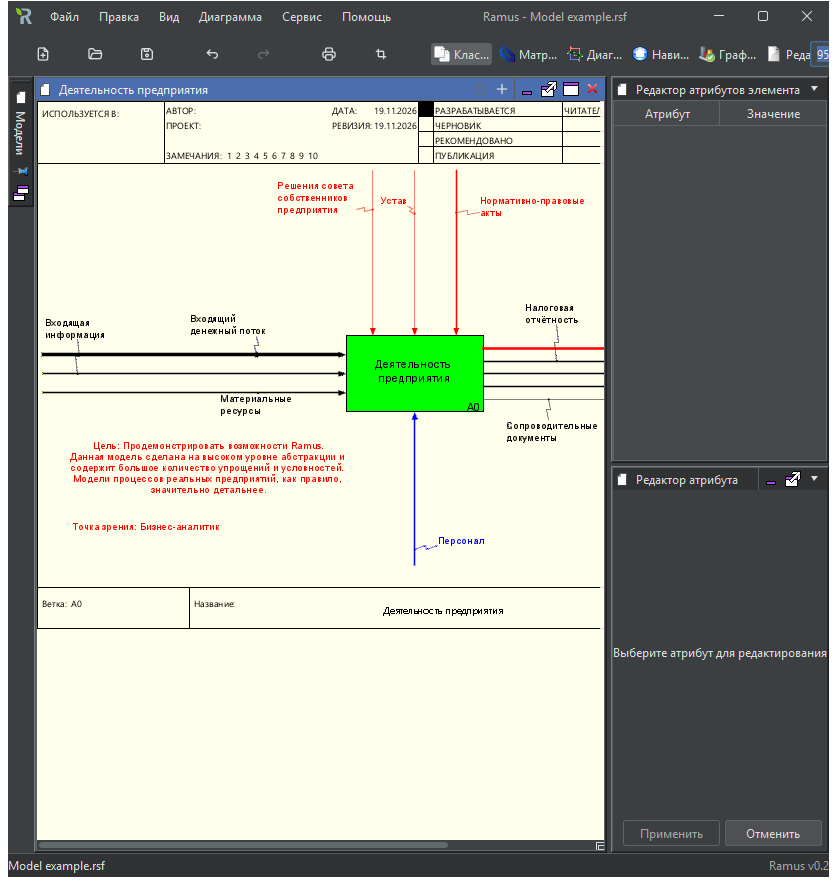

# Ramus Remaster — документация на русском

**Современный форк [Ramus](https://github.com/Vitaliy-Yakovchuk/ramus)** — Java-редактора бизнес-процессов в нотациях IDEF0 и DFD.


*Светлая тема*


*Тёмная тема (Вид → Переключить светлую/тёмную тему)*

## v0.2 — новый интерфейс

- **FlatLaf 3.8** — современный вид, светлая и тёмная темы; выбор темы
  сохраняется между запусками (переключатель: *Вид → Переключить светлую/тёмную тему*);
- **Современные иконки**: весь набор перерисован в едином outline-стиле (SVG)
  и следует за темой — включая кнопки рабочих пространств;
- **Палитра команд** `Ctrl+K` — быстрый переход к любому пункту меню;
- **Строка состояния** внизу окна (имя файла, версия);
- **Недавние файлы** в меню «Файл», автоматическое открытие последней модели;
- **Простой режим**: панель инструментов активна сразу после запуска;
- **Чёткие линии схем**: контуры элементов и стрелок — сплошные, рамка листа
  (АВТОР/ПРОЕКТ/ЗАМЕЧАНИЯ) — контрастная в обеих темах.

## Что изменено по сравнению с оригиналом

| Область | Оригинал | Remaster |
|---|---|---|
| JDK | 8 | 21 (Temurin) |
| Интерфейс | системный L&F (Metal/Windows) | FlatLaf 3.8, светлая и тёмная темы |
| H2 (встроенная БД .rsf) | 1.3.163 | 2.5.252 |
| POI / PDF / JFreeChart | 3.13 / iText 5.5.7 (AGPL) / 1.0.19 | 5.5.1 / OpenPDF 2.2.2 (LGPL) / 1.5.6 |
| Модули сборки | 28 (включая сервер, WebStart, izpack) | 18 — только локальный редактор |
| Тесты формата .rsf | нет | round-trip на всех образцах + операции модели |

### Совместимость с .rsf

- **Открытие**: remaster открывает все файлы оригинала 2.x, а также старые файлы
  эпохи Ramus 1.x. Если файл ссылается на плагины, которых в remaster нет
  (например `Attribute.Doc.Way`), они пропускаются с предупреждением в лог:
  `[Ramus] File requires unregistered plugins [...]`. Данные таких плагинов при
  сохранении теряются — сохраняйте такие файлы под новым именем.
- **Сохранение**: файлы, сохранённые remaster, открываются в оригинальном
  приложении (проверено вручную; см. `docs/baseline/t41_original_opens_remaster_saved.png`).

Подробности расследования багов открытия — в [`docs/rsf-load-bugs.md`](docs/rsf-load-bugs.md).

## Скачать и установить

Готовые сборки прикрепляются к [релизам](https://github.com/UwerfiU/ramus-remaster/releases)
при каждом пуше тега `v*` (собирает GitHub Actions). Все сборки содержат
собственный Java-рантайм — устанавливать JDK не нужно.

### Имена файлов в релизе

| Файл | Что это |
|---|---|
| `Ramus-<версия>-windows-x64-setup.exe` | установщик Windows с мастером (каталог + ярлыки) |
| `Ramus-<версия>-windows-x64.msi` | MSI для тихой/корпоративной установки |
| `Ramus-<версия>-macos-arm64.dmg` | macOS, Apple Silicon (M1/M2/…) |
| `Ramus-<версия>-macos-x86_64.dmg` | macOS, Intel |
| `Ramus-<версия>-linux-x64.deb` | Debian / Ubuntu |
| `Ramus-<версия>-linux-x64.rpm` | Fedora / RHEL / openSUSE |
| `Ramus-<версия>-linux-x64-portable.tar.gz` | портативная версия, установка не нужна |

### Windows

1. Рекомендуемый вариант — `Ramus-<версия>-windows-x64-setup.exe`: мастер
   установки позволяет выбрать каталог и поставить/снять галки ярлыков
   (рабочий стол и меню Пуск). Установка per-user, без прав администратора,
   ассоциация файлов `.rsf`. Удаление — через «Приложения и возможности».
2. `Ramus-<версия>-windows-x64.msi` — тот же продукт в виде MSI (тихая
   установка: `msiexec /i Ramus-…-windows-x64.msi /qn`), без мастера.
3. Портативная версия без установки (локальная сборка):
   ```bat
   gradlew.bat winPackage -PpackagingWinType=app-image
   ```
   → папка `dest\windows\Ramus\`, запускается `Ramus.exe`.

### macOS

1. Скачайте DMG под свой процессор: Apple Silicon (M1/M2/…) —
   `Ramus-<версия>-macos-arm64.dmg`, Intel — `Ramus-<версия>-macos-x86_64.dmg`.
2. Откройте DMG и перетащите **Ramus** в **Applications**.
3. Приложение не подписано, поэтому при первом запуске macOS заблокирует его:
   правый клик по Ramus в Finder → **Open** → **Open**, либо один раз выполните
   `xattr -dr com.apple.quarantine /Applications/Ramus.app`.

### Linux (x86_64)

- Портативная версия (любой дистрибутив): распакуйте
  `Ramus-<версия>-linux-x64-portable.tar.gz` и запустите `Ramus/bin/Ramus`
  (удобно сделать symlink в `~/bin`).
- Debian/Ubuntu: `sudo dpkg -i Ramus-…-linux-x64.deb`
- Fedora/RHEL: `sudo rpm -i Ramus-…-linux-x64.rpm` (или `dnf install ./Ramus-…-linux-x64.rpm`)

## Запуск из исходников

Требуется JDK 21 (например, Temurin). На Windows:

```bat
gradlew.bat runLocal
gradlew.bat runLocal -Popen="C:\path\to\model.rsf"
gradlew.bat runLocal -Ptheme=dark
```

Linux/macOS: `./gradlew ...` с теми же аргументами.

## Сборка и тесты

```bash
./gradlew build                          # компиляция + все тесты
./gradlew test                           # только тесты
```

## Упаковка

```bash
# Windows: портативная версия (папка с Ramus.exe, без установки; WiX не нужен)
./gradlew winPackage -PpackagingWinType=app-image
# → dest/windows/Ramus/  (Ramus.exe + app + runtime)

# Linux: портативная папка / deb / rpm — только на Linux (jpackage)
./gradlew linuxPackage -PpackagingLinuxType=app-image   # → dest/linux/Ramus/
./gradlew linuxPortable                                 # → Ramus-<версия>-linux-x64-portable.tar.gz
./gradlew linuxPackage -PpackagingLinuxType=deb         # → Ramus-<версия>-linux-x64.deb
./gradlew linuxPackage -PpackagingLinuxType=rpm         # → Ramus-<версия>-linux-x64.rpm
```

Инсталляторы собирает GitHub Actions при пуше тега вида `v0.1.0`:

- Windows EXE + MSI — `.github/workflows/windows-installer.yml` (EXE — мастер
  с выбором каталога и ярлыков; оба собираются, ставятся, проверяются на
  запуск/удаление, артефакты прикрепляются к релизу);
- macOS DMG (arm64 + x86_64) — `.github/workflows/macos-dmg.yml`;
- Linux (портативная папка + deb + rpm) — `.github/workflows/linux-packages.yml`
  (включая smoke-тест запуска под xvfb).

## Структура репозитория (кратко)

- `local-client` — точка входа (`com.ramussoft.local.Main`), лаунчер, задачи запуска/упаковки;
- `core`, `data-framework-common`, `database-storage` — движок и формат .rsf;
- `gui-*` — Swing-интерфейс (FlatLaf);
- `idef0-*` — нотация IDEF0;
- `docs/` — документация: карта модулей, баги загрузки, скриншоты.

## Лицензия

GNU GPL v3, как и оригинал. Оригинальная работа — Vitaliy Yakovchuk.

Все зависимости совместимы с GPL: OpenPDF (LGPL) вместо AGPL iText,
FlatLaf (LGPL), H2 (MPL/EPL), POI (Apache-2.0). Приложение можно
распространять как GPLv3 без AGPL-обязательств.
