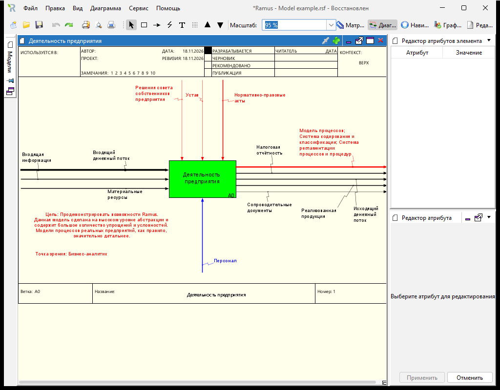
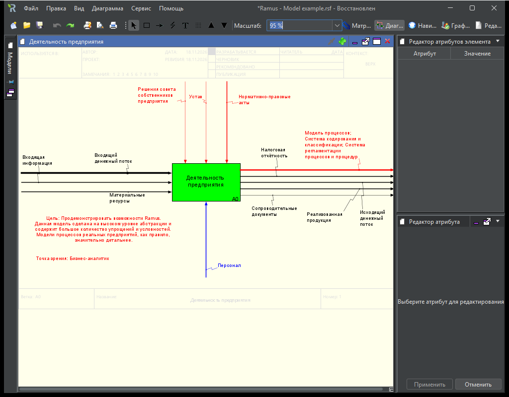

# Ramus Remaster

**Современный форк [Ramus](https://github.com/Vitaliy-Yakovchuk/ramus)** — Java-редактора бизнес-процессов в нотациях IDEF0 и DFD.

A modernized fork of **Ramus**, a Java-based IDEF0 & DFD business-process modeller.

| | |
|---|---|
| Русский | [README-RU.md](README-RU.md) |
| English | this file, sections below the Russian summary |

## Что в remaster / What's new

- **JDK 21** (оригинал — JDK 8) / modernized toolchain
- **FlatLaf 3.8** — современный вид интерфейса, светлая и тёмная темы (переключатель: *View → Toggle light/dark theme*)
- **Обновлены зависимости**: POI 5.5, iText 5.5.13, JFreeChart 1.5, H2 2.5
- **Совместимость с .rsf в обе стороны**:
  - remaster открывает старые файлы, включая эпохи Ramus 1.x (отсутствующие плагины пропускаются с предупреждением в лог);
  - файлы, сохранённые remaster, открываются в оригинальном приложении.
- **Упаковка**: портативная сборка (`app-image`) и Windows MSI через CI.


*Светлая тема / Light theme*


*Тёмная тема / Dark theme*

## Запуск из исходников / Run from source

Требуется JDK 21. / Requires JDK 21.

```bash
./gradlew runLocal                      # запуск приложения
./gradlew runLocal -Popen="path/to/model.rsf"   # открыть файл сразу
./gradlew runLocal -Ptheme=dark         # тёмная тема
```

## Сборка / Building

```bash
./gradlew build                         # compile + все тесты
./gradlew winPackage -PpackagingWinType=app-image   # портативная версия → dest/windows/Ramus/
```

Windows-инсталлятор (MSI) собирается GitHub Actions при пуше тега `v*`
(см. `.github/workflows/windows-installer.yml`); артефакты попадают в релиз.

The Windows installer (MSI) is built by GitHub Actions on `v*` tags;
artifacts are attached to the release.

## Формат файлов / Project format

Модели хранятся в `.rsf` — ZIP-архив с XML-таблицами и метаданными.
Формат полностью совместим с оригинальным Ramus 2.x (и с файлами 1.x при
открытии). Подробности — в `docs/rsf-load-bugs.md`.

Models are stored in `.rsf` — a ZIP archive of XML tables and metadata, fully
compatible with original Ramus 2.x (and readable from 1.x-era files).

## Лицензия / License

GNU GPL v3, как и оригинал. / Same as the original: GNU GPL v3.
Original work by Vitaliy Yakovchuk.
