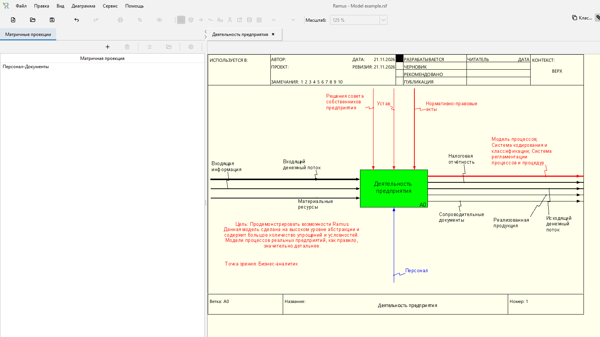

# Ramus Remaster

**Современный форк [Ramus](https://github.com/Vitaliy-Yakovchuk/ramus)** — Java-редактора бизнес-процессов в нотациях IDEF0 и DFD.

A modernized fork of **Ramus**, a Java-based IDEF0 & DFD business-process modeller.

| | |
|---|---|
| Русский | [README-RU.md](README-RU.md) |
| English | this file, sections below the Russian summary |

## Что в remaster / What's new

### v1.0 — новый интерфейс / fresh UI

- **FlatLaf 3.8** — современный вид, светлая и тёмная темы; выбор темы
  сохраняется между запусками (переключатель: *View → Switch light/dark theme*);
- **Современные иконки**: весь набор перерисован в едином outline-стиле
  (SVG) и следует за темой — включая кнопки рабочих пространств;
- **Палитра команд** `Ctrl+K` — быстрый переход к любому пункту меню;
- **Строка состояния** внизу окна (имя файла, версия);
- **Недавние файлы** в меню «Файл», автоматическое открытие последней модели;
- **Простой режим**: панель инструментов активна сразу после запуска;
- **Чёткие линии схем**: контуры элементов и стрелок — сплошные, рамка листа
  (АВТОР/ПРОЕКТ/ЗАМЕЧАНИЯ) — контрастная в обеих темах.

### База / the base

- **JDK 21** (оригинал — JDK 8) / modernized toolchain
- **Обновлены зависимости**: POI 5.5, OpenPDF (вместо AGPL iText), JFreeChart 1.5, H2 2.5
- **Совместимость с .rsf в обе стороны**:
  - remaster открывает старые файлы, включая эпохи Ramus 1.x (отсутствующие плагины пропускаются с предупреждением в лог);
  - файлы, сохранённые remaster, открываются в оригинальном приложении.
- **Упаковка**: инсталляторы и портативные сборки для Windows, macOS и Linux через CI
  (имена файлов — в таблице ниже / file names in the table below).


*Светлая тема / Light theme*


*Тёмная тема / Dark theme (View → Switch light/dark theme)*

## Установка / Installation

Готовые сборки появляются на странице [releases](https://github.com/UwerfiU/ramus-remaster/releases)
при каждом пуше тега `v*`. Все сборки содержат собственный Java-рантайм —
JDK на компьютере пользователя не нужен. / Ready-made builds are attached to
[releases](https://github.com/UwerfiU/ramus-remaster/releases) on every `v*` tag;
each one bundles its own Java runtime, so no JDK is needed on the user's machine.

### Имена файлов в релизе / Release file names

| Файл | Что это |
|---|---|
| `Ramus-<версия>-windows-x64-setup.exe` | установщик Windows с мастером (каталог + ярлыки) |
| `Ramus-<версия>-windows-x64.msi` | MSI для тихой/корпоративной установки |
| `Ramus-<версия>-macos-arm64.dmg` | macOS, Apple Silicon (M1/M2/…) |
| `Ramus-<версия>-macos-x86_64.dmg` | macOS, Intel |
| `Ramus-<версия>-linux-x64.deb` | Debian / Ubuntu |
| `Ramus-<версия>-linux-x64.rpm` | Fedora / RHEL / openSUSE |
| `Ramus-<версия>-linux-x64-portable.tar.gz` | портативная версия, установка не нужна |

| File | What it is |
|---|---|
| `Ramus-<version>-windows-x64-setup.exe` | Windows installer with a wizard (directory + shortcuts) |
| `Ramus-<version>-windows-x64.msi` | MSI for silent/enterprise installs |
| `Ramus-<version>-macos-arm64.dmg` | macOS, Apple Silicon (M1/M2/…) |
| `Ramus-<version>-macos-x86_64.dmg` | macOS, Intel |
| `Ramus-<version>-linux-x64.deb` | Debian / Ubuntu |
| `Ramus-<version>-linux-x64.rpm` | Fedora / RHEL / openSUSE |
| `Ramus-<version>-linux-x64-portable.tar.gz` | portable build, no installation needed |

### Windows

1. Рекомендуемый вариант — `Ramus-<версия>-windows-x64-setup.exe`: мастер
   установки позволяет выбрать каталог и поставить/снять галки ярлыков
   (рабочий стол и меню Пуск). Установка per-user, без прав администратора,
   ассоциация файлов `.rsf`. Удаление — через «Приложения и возможности».
2. `Ramus-<версия>-windows-x64.msi` — тот же продукт в виде MSI (тихая
   установка: `msiexec /i Ramus-…-windows-x64.msi /qn`), без мастера.
3. Портативная версия без установки (собирается локально):
   ```bat
   gradlew.bat winPackage -PpackagingWinType=app-image
   ```
   → папка `dest\windows\Ramus\`, запускается `Ramus.exe`.

1. Recommended: `Ramus-<version>-windows-x64-setup.exe` — its wizard lets you
   choose the install directory and tick/untick the shortcuts (desktop and
   Start menu). Per-user install, no administrator rights, `.rsf` association.
   Uninstall via "Apps & features".
2. `Ramus-<version>-windows-x64.msi` — the same product as an MSI (silent:
   `msiexec /i Ramus-…-windows-x64.msi /qn`), without the wizard options.
3. Portable version without installation (built locally):
   ```bat
   gradlew.bat winPackage -PpackagingWinType=app-image
   ```
   → `dest\windows\Ramus\` folder, run `Ramus.exe`.

### macOS

1. Скачайте DMG под свой процессор: Apple Silicon (M1/M2/…) —
   `Ramus-<версия>-macos-arm64.dmg`, Intel — `Ramus-<версия>-macos-x86_64.dmg`.
2. Откройте DMG и перетащите **Ramus** в **Applications**.
3. Приложение не подписано, поэтому при первом запуске macOS заблокирует его:
   правый клик по Ramus в Finder → **Open** → **Open**
   (либо один раз выполните `xattr -dr com.apple.quarantine /Applications/Ramus.app`).

1. Download the DMG for your chip: Apple Silicon (M1/M2/…) —
   `Ramus-<version>-macos-arm64.dmg`, Intel — `Ramus-<version>-macos-x86_64.dmg`.
2. Open the DMG and drag **Ramus** into **Applications**.
3. The app is unsigned, so macOS blocks it on first launch: right-click Ramus in
   Finder → **Open** → **Open** (or run
   `xattr -dr com.apple.quarantine /Applications/Ramus.app` once).

### Linux

- Портативная версия (любой дистрибутив, x86_64): распакуйте
  `Ramus-<версия>-linux-x64-portable.tar.gz` и запустите `Ramus/bin/Ramus`
  (удобно сделать symlink в `~/bin`).
- Debian/Ubuntu: `sudo dpkg -i Ramus-…-linux-x64.deb`
- Fedora/RHEL: `sudo rpm -i Ramus-…-linux-x64.rpm` (или `dnf install ./Ramus-…-linux-x64.rpm`)

- Portable build (any x86_64 distro): unpack
  `Ramus-<version>-linux-x64-portable.tar.gz` and run `Ramus/bin/Ramus`
  (a symlink in `~/bin` is convenient).
- Debian/Ubuntu: `sudo dpkg -i Ramus-…-linux-x64.deb`
- Fedora/RHEL: `sudo rpm -i Ramus-…-linux-x64.rpm` (or `dnf install ./Ramus-…-linux-x64.rpm`)

## Запуск из исходников / Run from source

Требуется JDK 21. / Requires JDK 21.

```bash
./gradlew runLocal                      # запуск приложения
./gradlew runLocal -Popen="path/to/model.rsf"   # открыть файл сразу
./gradlew runLocal -Ptheme=dark         # тёмная тема
```

## Сборка / Building

```bash
./gradlew build                         # compile + все тесты / all tests
./gradlew winPackage -PpackagingWinType=app-image   # портативная версия → dest/windows/Ramus/
./gradlew linuxPackage -PpackagingLinuxType=app-image  # только на Linux → dest/linux/Ramus/
```

Инсталляторы (Windows MSI, macOS DMG, Linux deb/rpm) собирает GitHub Actions
при пуше тега `v*`; артефакты прикрепляются к релизу.

Installers (Windows MSI, macOS DMG, Linux deb/rpm) are built by GitHub Actions
on `v*` tags and attached to the release.

## Формат файлов / Project format

Модели хранятся в `.rsf` — ZIP-архив с XML-таблицами и метаданными.
Формат полностью совместим с оригинальным Ramus 2.x (и с файлами 1.x при
открытии). Подробности — в `docs/rsf-load-bugs.md`.

Models are stored in `.rsf` — a ZIP archive of XML tables and metadata, fully
compatible with original Ramus 2.x (and readable from 1.x-era files).

## Лицензия / License

GNU GPL v3, как и оригинал. / Same as the original: GNU GPL v3.
Original work by Vitaliy Yakovchuk.

Зависимости совместимы с GPL: OpenPDF (LGPL) вместо AGPL iText,
FlatLaf (LGPL), H2 (MPL/EPL). Приложение можно распространять как GPLv3.
/ Dependencies are GPL-compatible: OpenPDF (LGPL) instead of AGPL iText,
FlatLaf (LGPL), H2 (MPL/EPL). The application can be distributed as GPLv3.
