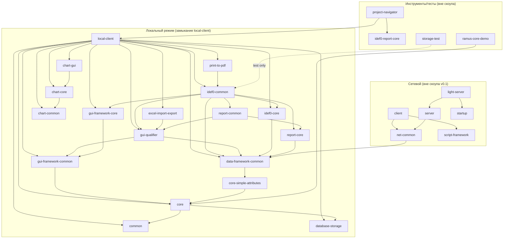

# T1.1: Карта зависимостей модулей (Ramus Remaster)

Цель: определить минимальный набор Gradle-модулей для **локального режима**
(входная точка `com.ramussoft.local.Main`, запуск `./gradlew runLocal` в модуле
`local-client`) и список модулей, которые можно вынести из `settings.gradle`
в задаче T1.3 (скоуп v0.1 — только локальный редактор).

Анализ выполнен по `build.gradle` каждого модуля (`implementation`/`api project(":...")`)
и по регистрациям плагинов (`META-INF/services`, хардкод). Код не изменялся.

---

## 1. Граф зависимостей между модулями

Стрелка `A -> B` означает «A зависит от B».

```
local-client ──> common, core, database-storage, data-framework-common,
                gui-framework-common, gui-framework-core, gui-qualifier,
                idef0-core, idef0-common, excel-import-export, print-to-pdf,
                chart-common, chart-core, chart-gui (+ h2, TableLayout)

idef0-common ──> gui-framework-common, gui-framework-core, idef0-core,
                 report-common, common, core, report-core, gui-qualifier,
                 core-simple-attributes, database-storage, data-framework-common
report-common ──> common, core-simple-attributes, data-framework-common,
                  gui-framework-common, report-core, gui-qualifier
print-to-pdf ──> gui-framework-common, idef0-common
excel-import-export ──> gui-qualifier, common, core, core-simple-attributes,
                        data-framework-common, gui-framework-common
chart-gui ──> common, core, core-simple-attributes, data-framework-common,
              gui-framework-common, gui-qualifier, chart-common, chart-core
chart-core ──> chart-common, core, common, core-simple-attributes
chart-common ──> common, core, core-simple-attributes
gui-qualifier ──> common, core, data-framework-common, core-simple-attributes,
                  gui-framework-common (+ my-spell*.jar)
gui-framework-core ──> gui-framework-common, common
gui-framework-common ──> common, core
idef0-core ──> common, core, core-simple-attributes, database-storage,
               data-framework-common
report-core ──> data-framework-common, database-storage, common, core,
                core-simple-attributes
data-framework-common ──> core-simple-attributes, common, database-storage, core
core-simple-attributes ──> core, common, database-storage
core ──> common, database-storage
database-storage ──> (нет project-зависимостей)
common ──> (нет project-зависимостей)

--- модули вне замыкания local-client ---
project-navigator ──> idef0-common, idef0-core, idef0-report-core,
                      LOCAL-CLIENT (!), gui-framework-common, common,
                      data-framework-common, core
idef0-report-core ──> database-storage, common, core-simple-attributes,
                      data-framework-common, report-core, idef0-core
script-framework ──> data-framework-common, database-storage, core,
                     gui-qualifier, common, gui-framework-common
client (сеть) ──> data-framework-common, common, core, core-simple-attributes,
                  gui-framework-core, gui-framework-common, database-storage,
                  net-common, gui-qualifier, idef0-common, excel-import-export,
                  script-framework (+ hessian, jnlp)
light-server (сеть) ──> common, gui-framework-common, gui-qualifier, startup, server
server (сеть) ──> database-storage, data-framework-common, core-simple-attributes,
                  common, core, net-common, idef0-core (+ acegi-security)
net-common (сеть) ──> data-framework-common, common
startup ──> (нет project-зависимостей; Main-Class com.ramussoft.RamusLocalStartup)
storage-test ──> только testImplementation: common, core, database-storage,
                 core-simple-attributes, data-framework-common, idef0-core,
                 idef0-common, report-core, chart-core (+ h2)
ramus-core-demo ──> core (impl); idef0-core, report-core, chart-core (runtimeOnly);
                    core-simple-attributes, common, data-framework-common (+ h2)
```

Mermaid (для рендеринга):



---

## 2. Транзитивное замыкание от `local-client`

Прямые зависимости (14): common, core, database-storage, data-framework-common,
gui-framework-common, gui-framework-core, gui-qualifier, idef0-core, idef0-common,
excel-import-export, print-to-pdf, chart-common, chart-core, chart-gui.

Добавляются транзитивно: **report-common** (через `idef0-common`),
**report-core** (через `idef0-common` и `report-common`).

Итого **18 модулей**:

| # | Модуль |
|---|--------|
| 1 | local-client |
| 2 | common |
| 3 | database-storage |
| 4 | core |
| 5 | core-simple-attributes |
| 6 | data-framework-common |
| 7 | gui-framework-common |
| 8 | gui-framework-core |
| 9 | gui-qualifier |
| 10 | idef0-core |
| 11 | idef0-common |
| 12 | report-core |
| 13 | report-common |
| 14 | chart-common |
| 15 | chart-core |
| 16 | chart-gui |
| 17 | excel-import-export |
| 18 | print-to-pdf |

---

## 3. Таблица статусов по всем модулям settings.gradle

settings.gradle включает 29 записей (`:script-framework` указан дважды — дубликат).

| Модуль | Статус | Обоснование |
|--------|--------|-------------|
| local-client | **нужен** | Точка входа локального режима (`com.ramussoft.local.Main`, `runLocal`). |
| common | **нужен** | Базовый API (Engine, Plugin, ServiceLoader-загрузчики плагинов). Корень графа. |
| database-storage | **нужен** | JDBC/H2-слой хранения .rsf; зависит от него core. |
| core | **нужен** | Ядро движка (IEngineImpl и т.д.). |
| core-simple-attributes | **нужен** | Плагины Core/Eval/Autochange/Attribute.Core.* — критично для открытия .rsf (см. §4). |
| data-framework-common | **нужен** | MemoryDatabase/H2Database: хардкод `SimpleAttributePluginSuit` + ServiceLoader PluginProvider. |
| gui-framework-common | **нужен** | GUI-фреймворк, AdditionalGUIPluginLoader (ServiceLoader GUIPluginProvider). |
| gui-framework-core | **нужен** | GUI-рама (docking frames), прямая зависимость local-client. |
| gui-qualifier | **нужен** | Редактор атрибутов/квалификаторов; нужен idef0-common (GUI) и excel-import-export. |
| idef0-core | **нужен** | Плагин IDEF0 + Attribute.IDEF0.* (META-INF/services PluginProvider). Критично для .rsf. |
| idef0-common | **нужен** | GUI плагин IDEF0 (GUIPluginProvider), печатные формы, прямая зависимость local-client. |
| report-core | **нужен** | Транзитивно через idef0-common; ReportPluginProvider + StantardPluginProvider (ConnectionPluginProvider). |
| report-common | **нужен** | Транзитивно через idef0-common; ReportGUIPluginProvider. |
| chart-common | **нужен** | Прямая зависимость local-client (JFreeChart-база). |
| chart-core | **нужен** | Прямая зависимость local-client; ChartPluginProvider (META-INF/services). |
| chart-gui | **нужен** | Прямая зависимость local-client; ChartGUIProvider (META-INF/services). |
| excel-import-export | **нужен** | Прямая зависимость local-client; ExcelPluginProvider (GUIPluginProvider). |
| print-to-pdf | **нужен** | Прямая зависимость local-client; PrintPlugin (iText). |
| client | **не нужен** | Сетевой GUI-клиент (hessian-RPC к server, JNLP). Вне скоупа v0.1. |
| light-server | **не нужен** | Лёгкий сетевой сервер (зависит от server и startup). |
| net-common | **не нужен** | Протокол сети; используется только client и server. |
| server | **не нужен** | Полноценный сетевой сервер (acegi-security, hessian). |
| startup | **не нужен** | Pack200-стартер `RamusLocalStartup`; единственный потребитель — light-server. Упоминается в packaging-задачах корневого build.gradle (`moveStartup`, `copyJars`) — при удалении их надо поправить (T1.3). |
| script-framework | **не нужен** | JS/Ruby-скрипты; GUIPluginProvider ScriptGUIPluginProvider не входит в метаданные образцов .rsf; единственный потребитель — client. |
| project-navigator | **не нужен** | Отдельный инструмент-навигатор; обращённая зависимость от local-client (сам local-client им не пользуется). Использует idef0-report-core. |
| idef0-report-core | **не нужен*** | ConnectionPluginProvider для IDEF0-соединений отчётов; единственный потребитель — project-navigator. *Оговорка: если образцы .rsf используют IDEF0-подключения данных в отчётах, модуль придётся вернуть (загрузка через `Data.loadProviders(ConnectionPluginProvider)` в report-core). По заявленному набору плагинов метаданных (Core, Attribute.Core.*, Eval, Autochange, IDEF0, Attribute.IDEF0.*) не требуется. |
| storage-test | **не нужен** | Чисто тестовый harness (только testImplementation); для локального режима не нужен. Можно сохранить, если хотим прогонять storage-тесты в T1.x. |
| ramus-core-demo | **не нужен** | CLI-демо rsf↔yaml (`rsfToYaml`/`yamlToRsf`). Не входит в замыкание local-client; все его зависимости остаются, так что модуль легко вернуть позже для проверки формата. |

Примечание: каталоги `web-service`, `packaging`, `dest` существуют на диске, но
**не включены** в settings.gradle — на сборку не влияют.

---

## 4. Плагины, критичные для открытия .rsf

Механизм загрузки (локальный режим):
- `data-framework-common.MemoryDatabase.loadSuits()` / `H2Database`: хардкод
  `new SimpleAttributePluginSuit()` + `getAdditionalSuits()` +
  `common.AdditionalPluginLoader` → `ServiceLoader<com.ramussoft.common.PluginProvider>`.
- GUI: `gui-framework-common.AdditionalGUIPluginLoader` →
  `ServiceLoader<com.ramussoft.gui.common.GUIPluginProvider>`.
- `local-client` shadowJar использует `mergeServiceFiles()` — в fat-jar сливаются
  все META-INF/services зависимых модулей, т.е. набор плагинов = объединение по
  всем 18 модулям из §2.

| Модуль | Регистрация | Провайдер | Плагины |
|--------|-------------|-----------|---------|
| core-simple-attributes | **хардкод** (MemoryDatabase/H2Database в data-framework-common) | `SimpleAttributePluginSuit` | StandardAttributesPlugin (**Core**-атрибуты), **AutochangePlugin**, **EvalPlugin**, Attribute.Core.*: Text, Double, Long, Date, Boolean, OtherElement, ElementList, Variant, File, HTMLText, Table, Currency, Price; системные: Hierarchical, Icon, Function |
| idef0-core | META-INF/services `com.ramussoft.common.PluginProvider` | `IDEF0PluginProvider` | **IDEF0** (IDEF0Plugin) + Attribute.IDEF0.*: FRectangle, Status, Font, FunctionOwner, FunctionType, VisualData, Color, AnyToAny, Sector, SectorBorder, ProjectPreferences, DecompositionType, SectorPoint, SectorProperties, DFDSName, TextLabel; также `ElementLoadFilter` → IDEF0FunctionFilter |
| idef0-common | META-INF/services `com.ramussoft.gui.common.GUIPluginProvider` | `IDEF0GUIPluginProvider` | GUI-плагины IDEF0 (редактор диаграмм) |
| report-core | META-INF/services PluginProvider + ConnectionPluginProvider | ReportPluginProvider; StantardPluginProvider | Report-плагин, стандартные соединения данных отчётов |
| report-common | META-INF/services GUIPluginProvider | ReportGUIPluginProvider | GUI отчётов |
| chart-core | META-INF/services PluginProvider | ChartPluginProvider | Chart (диаграммы) |
| chart-gui | META-INF/services GUIPluginProvider | ChartGUIProvider | GUI диаграмм |
| excel-import-export | META-INF/services GUIPluginProvider | ExcelPluginProvider | Импорт/экспорт Excel |
| print-to-pdf | META-INF/services `com.ramussoft.gui.common.PrintPlugin` | `print.to.pdf.Plugin` | Печать в PDF |

Все плагины из метаданных образцов (Core, Attribute.Core.*, Eval, Autochange,
IDEF0, Attribute.IDEF0.*) зарегистрированы в модулях **core-simple-attributes**,
**idef0-core** и **idef0-common** — все они входят в замыкание local-client.

Вне локального замыкания (удаляются вместе с модулями):
- `script-framework` → ScriptGUIPluginProvider (GUIPluginProvider);
- `idef0-report-core` → com.dsoft.pb.idef.report.IDEF0PluginProvider (ConnectionPluginProvider).

---

## 5. Итог для T1.3: что вынести из settings.gradle

**Удаляем (10 модулей):**

```
client
light-server
net-common
server
startup
script-framework
project-navigator
idef0-report-core
storage-test
ramus-core-demo
```

(плюс убираем дублирующую строку `include ':script-framework'`.)

**Оставляем (18 модулей):**

```
common, database-storage, core, core-simple-attributes, data-framework-common,
gui-framework-common, gui-framework-core, gui-qualifier, idef0-core, idef0-common,
report-core, report-common, chart-common, chart-core, chart-gui,
excel-import-export, print-to-pdf, local-client
```

Побочные эффекты для T1.3:
1. Корневой `build.gradle`: packaging-задачи `copyJars`/`moveStartup` ссылаются на
   jar'ы `startup`, `client`, `server` — их нужно поправить или вынести.
2. Каталог `web-service` уже не в settings; после T1.3 его можно не трогать.
3. `storage-test` и `ramus-core-demo` легко вернуть, если понадобятся для
   проверки формата .rsf (их зависимости все остаются).
